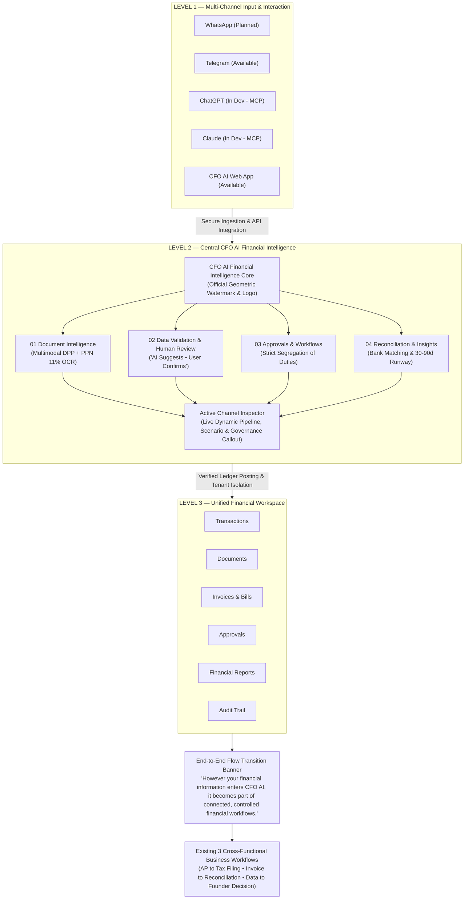

# CFO AI — Connected Financial Intelligence Experience Delivery Report

**Project:** CFO AI Indonesia  
**Public Website:** `https://cfo-ai.site`  
**Financial Application:** `https://app.cfo-ai.site`  
**Branch:** `feat/cfo-ai-website-cms-hub`  
**Working Commit:** `47ac621`  
**Status:** **DESIGN AWAITING FINAL OWNER APPROVAL**

---

## 1. Executive Summary

In accordance with owner guidance, the CFO AI marketing website's **Platform** page (`/platform`) has been enhanced with a premium, visually engaging **"Connected Financial Intelligence Experience"** architecture.

This section directly solves the perception problem of CFO AI being viewed as an isolated collection of accounting tools. It positions CFO AI as a **connected financial operating system** where multi-channel inputs (WhatsApp, Telegram, ChatGPT, Claude, and Web App) flow through a centralized financial validation core ("AI Suggests • User Confirms") into an immutable, unified financial workspace.

---

## 2. Technical Codebase Audit & Truth in Marketing

Before writing any user-facing claims, a strict technical audit was executed against the production application codebase (`server/index.js`, `server/routes/`, `server/mcp/`, `server/lib/`). All website copy and status badges strictly reflect reality:

| Channel | Codebase Evidence | Marketing Status Tag | Permitted Marketing Claim | Strictly Prohibited Claim |
| :--- | :--- | :--- | :--- | :--- |
| **WhatsApp** | `server/index.js:1523` lists `'whatsapp_future'`. No webhook or bot implementation exists. | `Planned` | Receipt intake and alerts are on the product roadmap. | Never claim live WhatsApp receipt auto-parsing or live bot posting. |
| **Telegram** | Verified `telegramActor.js`, `telegramWorkspace.js`, and inline approval endpoints (`POST /api/telegram/debts/:id/approve` and `reject`). | `Available` | Real-time balance queries, runway checks, and inline expense approval/rejection. | Do not claim active OCR extraction from Telegram photos. |
| **ChatGPT** | Model Context Protocol (`server/mcp/server.js`, `tools.js`, `oauth/provider.js`) with RFC 9728 endpoints. Gated by `MCP_SERVER_ENABLED`. | `In Development (MCP)` | Read-only conversational queries against ledger summaries and documents. | No automatic journal entry posting without human confirmation. |
| **Claude** | Anthropic MCP connector (`oauth/provider.js`) with Claude Code & Desktop OAuth support. Gated by `MCP_SERVER_ENABLED`. | `In Development (MCP)` | Deep financial analysis with verifiable voucher citations. Write actions restricted to pending drafts. | No direct database mutations without human review. |
| **CFO AI Web App** | Multi-format upload (PDF, JPG, PNG), bank statement import (CSV, MT940), approval queues, reconciliation workbench. | `Available` | Multi-format document intake, automated DPP/PPN tax extraction, full general ledger. | — |

*Detailed technical capability matrix is archived at [`CFO_AI_INTEGRATION_CAPABILITY_MATRIX.md`](file:///c:/Users/HUAWEI/Desktop/helm-finance-web/CFO_AI_INTEGRATION_CAPABILITY_MATRIX.md).*

---

## 3. Visual & Interactive Implementation Details

### A. Position on the Platform Page
- Located immediately after the **Platform Hero** section.
- Positioned directly before the **Three Business Workflows** ("How CFO AI Works").
- Positioned before the detailed **14 Product Module Showcases**.

### B. Visual System Compliance (Concept B+)
- **Background:** Soft Ice Blue (`bg-ice-primary`, `#F0F4F8`) with clean slate border (`border-b border-[#CBD5E1]`).
- **Watermarks:** Official CFO AI geometric mark rendered as a transparent SVG watermark (`opacity: 0.03-0.04`).
- **Color Palette:**
  - Dark Navy: `#06366B`
  - Luminous Accent Blue: `#1768C9`, `#318FF4`
  - Brand Card Glow: `border-2 border-[#1768C9]/30`
  - Ice Blue Highlights: `#F8FAFC`, `#E2E8F0`
- **Zero Emojis:** 100% verified across all strings, SVG icons, badges, and layout scripts.

### C. Interactive Channel Selection (`selectPlatformChannel`)
Clicking or pressing Enter/Space on any of the 5 channel cards dynamically updates the interface in real time:
1. Elevates the active card with an active blue border (`border-[#1768C9]`), ring (`ring-2 ring-[#1768C9]/20`), and soft blue background (`bg-blue-50/30`).
2. Updates `aria-selected="true"` for WCAG accessibility.
3. Dynamically updates the **Active Channel Inspector** in Level 2:
   - Channel Name & Verified Status Tag (with matching emerald/amber/slate color).
   - Business Scenario quote.
   - End-to-End Pipeline flow breadcrumbs.
   - Governance & Controls boundary explanation.

### D. Multi-Locale Support (EN, ID, RU)
Full translations implemented in [`cms/server/translations.js`](file:///c:/Users/HUAWEI/Desktop/helm-finance-web/cms/server/translations.js):
- **English:** `"Your Financial Data. One Intelligent System."`
- **Indonesian:** `"Data Keuangan Anda. Satu Sistem Cerdas."`
- **Russian:** `"Ваши финансовые данные. Единый интеллект."`

---

## 4. Visual QA & Verification Evidence

All automated visual QA checks executed using headless Chrome via `playwright-core`. Screenshots are saved in the project repository and artifact directories:

| Viewport / State | Description | Artifact Link |
| :--- | :--- | :--- |
| **Desktop 1440px (Default)** | Full section with CFO AI Web App active, 3 levels, transition banner | [connected-workspace-1440px-default.png](file:///c:/Users/HUAWEI/Desktop/helm-finance-web/screenshots/connected-workspace-1440px-default.png) |
| **Telegram Active** | Interactive state: Telegram selected, "Available" badge, approval flow | [connected-workspace-telegram-active.png](file:///c:/Users/HUAWEI/Desktop/helm-finance-web/screenshots/connected-workspace-telegram-active.png) |
| **Claude Active** | Interactive state: Claude selected, "In Development" badge, MCP citations | [connected-workspace-claude-active.png](file:///c:/Users/HUAWEI/Desktop/helm-finance-web/screenshots/connected-workspace-claude-active.png) |
| **WhatsApp Active** | Interactive state: WhatsApp selected, "Planned" badge, roadmap flow | [connected-workspace-whatsapp-active.png](file:///c:/Users/HUAWEI/Desktop/helm-finance-web/screenshots/connected-workspace-whatsapp-active.png) |
| **Laptop 1280px** | Responsive 5-column channel grid and bento engine card | [connected-workspace-1280px.png](file:///c:/Users/HUAWEI/Desktop/helm-finance-web/screenshots/connected-workspace-1280px.png) |
| **Tablet 768px** | 2-column channel grid, touch targets &ge; 44px, balanced padding | [connected-workspace-768px.png](file:///c:/Users/HUAWEI/Desktop/helm-finance-web/screenshots/connected-workspace-768px.png) |
| **Mobile 390px** | Clean vertical stacking, no horizontal overflow, legible typography | [connected-workspace-390px.png](file:///c:/Users/HUAWEI/Desktop/helm-finance-web/screenshots/connected-workspace-390px.png) |
| **Indonesian (ID)** | Localized Indonesian copy: "Data Keuangan Anda. Satu Sistem Cerdas." | [connected-workspace-id-1440px.png](file:///c:/Users/HUAWEI/Desktop/helm-finance-web/screenshots/connected-workspace-id-1440px.png) |
| **Russian (RU)** | Localized Russian copy: "Ваши финансовые данные. Единый интеллект." | [connected-workspace-ru-1440px.png](file:///c:/Users/HUAWEI/Desktop/helm-finance-web/screenshots/connected-workspace-ru-1440px.png) |
| **Platform Page Full** | Complete page overview showing hero &rarr; connected workspace &rarr; workflows &rarr; modules &rarr; floating CTA &rarr; footer | [platform-v4-full-1440px.png](file:///c:/Users/HUAWEI/Desktop/helm-finance-web/screenshots/platform-v4-full-1440px.png) |

---

## 5. Live Staging Preview Surfaces

Both surfaces are running live and accessible:

- **Public Website Preview (HTTPS):**  
  `https://buttons-limiting-attached-connector.trycloudflare.com/en/platform`  
  *(Also accessible locally at `http://localhost:3002/en/platform`)*

- **CMS Studio Preview (HTTPS):**  
  `https://participants-louise-bras-emerging.trycloudflare.com/admin/`  
  *(Gateway: `cfo-admin` / `cfo-staging-pass-2026`)*

---

## 6. Audit & Governance Checklist

- [x] **Files changed:** `cms/server/publicRoutes.js`, `cms/server/translations.js`, `CFO_AI_INTEGRATION_CAPABILITY_MATRIX.md`, `scratch/verify_connected_workspace.js`.
- [x] **Tests run:** `node cms/test_cms_suite.js` (56/56 passing), `node scratch/verify_connected_workspace.js` (all viewports and interactive states verified).
- [x] **Workspace type affected:** Platform/admin (public marketing website surface only).
- [x] **Flags touched:** None. Gating flags (`MCP_SERVER_ENABLED`, etc.) preserved.
- [x] **Migrations touched:** None (0 database migrations).
- [x] **Production impact:** Zero. Work restricted to staging branch `feat/cfo-ai-website-cms-hub`. No changes to backend auth, Supabase schemas, or Stripe/Xendit billing.
- [x] **Status:** `DESIGN AWAITING FINAL OWNER APPROVAL`.
