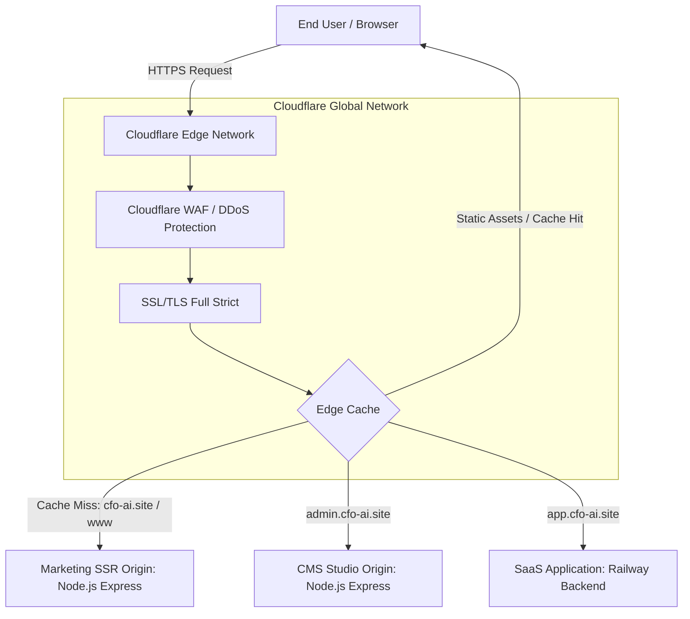

# CFO AI — Cloudflare Production DNS Cutover Runbook
**Target Domain:** `cfo-ai.site`  
**Registrar:** GoDaddy  
**Target Edge Network:** Cloudflare  
**Author:** CFO AI Infrastructure & Engineering Team  
**Date:** October 18, 2026  
**Status:** READY FOR OPERATOR EXECUTION (Owner Approval Mandatory Before Step 3)

---

## 1. Safety Rules & Pre-Cutover Verification

> [!CAUTION]
> **DO NOT DEPLOY TO PRODUCTION OR MODIFY LIVE DNS WITHOUT EXPLICIT OWNER APPROVAL.**  
> Under `AGENTS.md` and repository rules, all AI agents must pause before modifying production DNS, GoDaddy nameservers, or live SaaS infrastructure.

### Pre-Cutover Checklist
- [x] Dedicated Git working branch created: `feat/cfo-ai-cloudflare-launch`.
- [x] All 10 marketing pages verified with 0 `undefined` and 0 emojis.
- [x] All 11 languages verified with 100% key parity (239 paths).
- [x] Commercial pricing locked: Starter $59, Control $149 (RECOMMENDED), Pro $249.
- [x] Automated test suite passing 100% (126 / 126 assertions).
- [x] Cloudflare quick tunnel staging preview operational.
- [x] Node.js SSR Origin server running and reachable.

---

## 2. Target Architecture Overview



### Subdomain Delegation Plan
| Subdomain | Role | Origin Service | Cloudflare Proxy |
|---|---|---|:---:|
| `cfo-ai.site` | Apex Marketing Website | Node.js SSR Container (Port 3002) | **Proxied (Orange Cloud)** |
| `www.cfo-ai.site` | Canonical CNAME | Redirect to `cfo-ai.site` | **Proxied (Orange Cloud)** |
| `admin.cfo-ai.site`| CMS Studio | Node.js CMS Surface (Port 3003) | **Proxied (Orange Cloud)** |
| `app.cfo-ai.site` | CFO AI V2 SaaS Platform | Railway Production App | **Proxied (Orange Cloud)** |

---

## 3. Step-by-Step Cutover Procedure

### Step 1: Create and Configure Cloudflare Zone
1. Log in to the official **Cloudflare Dashboard** (`dash.cloudflare.com`).
2. Click **Add a Domain** and enter: `cfo-ai.site`.
3. Select the **Free** or **Pro** plan.
4. Allow Cloudflare to scan existing DNS records.

### Step 2: Configure Production DNS Records in Cloudflare
Add or verify the following records in the Cloudflare DNS management tab:

| Type | Name | Content / Target | Proxy Status | TTL |
|---|---|---|:---:|:---:|
| `A` | `@` (or `cfo-ai.site`) | `<ORIGIN_NODEJS_SERVER_IP>` | **Proxied** | Auto |
| `CNAME` | `www` | `cfo-ai.site` | **Proxied** | Auto |
| `A` | `admin` | `<ORIGIN_NODEJS_SERVER_IP>` | **Proxied** | Auto |
| `CNAME` | `app` | `<RAILWAY_APP_DOMAIN>` (e.g., `helm-production.up.railway.app`) | **Proxied** | Auto |

### Step 3: Configure Cloudflare Security & Caching Rules

#### 1. SSL/TLS Settings
- Navigate to **SSL/TLS** > **Overview**.
- Select encryption mode: **Full (strict)**.
- Navigate to **Edge Certificates**:
  - Enable **Always Use HTTPS**: ON.
  - Enable **Automatic HTTPS Rewrites**: ON.
  - Minimum TLS Version: **TLS 1.2** (TLS 1.3 recommended).

#### 2. Page Rules / Cache Rules
Navigate to **Caching** > **Cache Rules** and create two rules:

**Rule 1: Static Assets Edge Caching**
- Match: `(http.request.uri.path starts_with "/assets/")`
- Cache eligibility: Eligible for cache.
- Edge TTL: 7 days.
- Browser TTL: 1 day.

**Rule 2: HTML Page Dynamic Caching**
- Match: `(http.host eq "cfo-ai.site" and not http.request.uri.path starts_with "/api/" and not http.request.uri.path starts_with "/admin/")`
- Cache eligibility: Eligible for cache.
- Edge TTL: 2 hours with `stale-while-revalidate`.
- Serve stale content while revalidating: Enabled.

#### 3. Cloudflare Access for CMS Admin (Recommended)
- Navigate to **Zero Trust** > **Access** > **Applications**.
- Add application for `admin.cfo-ai.site`.
- Enforce team email verification (e.g. OTP code sent to `owner@cfo-ai.site`).

### Step 4: GoDaddy Nameserver Delegation (EXECUTE ONLY AFTER OWNER GO)
1. Log in to the **GoDaddy Domain Control Center** (`dcc.godaddy.com`).
2. Select domain: `cfo-ai.site`.
3. Click **Manage DNS** > **Nameservers**.
4. Select **Change Nameservers** > **Enter my own nameservers (advanced)**.
5. Replace existing GoDaddy nameservers with the assigned Cloudflare nameservers (e.g.):
   - `ns1.cloudflare.com` (use exact names provided by Cloudflare)
   - `ns2.cloudflare.com`
6. Click **Save** and confirm the two-step verification prompt.

---

## 4. Post-Cutover Verification Smoke Tests

Once nameserver propagation begins (typically 5 to 30 minutes), execute the verification suite:

```bash
# 1. Verify Public Homepage resolution
curl -I https://cfo-ai.site/en

# Expected Output:
# HTTP/2 200
# cf-cache-status: HIT (or MISS on first load)
# content-type: text/html; charset=utf-8

# 2. Verify Root Language Redirect
curl -I https://cfo-ai.site/

# Expected Output:
# HTTP/2 302
# location: /id (or /en depending on accept-language)

# 3. Verify Staged Draft Protection (noindex)
curl -I https://cfo-ai.site/zh-cn

# Expected Output:
# HTTP/2 200
# x-robots-tag: noindex, nofollow

# 4. Verify Pricing Consistency
curl -s https://cfo-ai.site/en/pricing | grep -E "(\$59|\$149|\$249)"

# 5. Verify XML Sitemap
curl -s https://cfo-ai.site/sitemap.xml | grep "<loc>" | head -10
```

---

## 5. Emergency Rollback Procedure (< 5 Minutes)

If an unforeseen routing conflict, SSL handshaking failure, or application disruption occurs during cutover, execute this instant rollback:

1. **Immediate Action — GoDaddy Rollback:**
   - Log in to GoDaddy Domain Control Center.
   - Click **Manage DNS** > **Nameservers**.
   - Click **Revert to Default GoDaddy Nameservers**.
   - Propagation will restore original DNS routing within 3 to 10 minutes.

2. **Cloudflare Pause Option (Alternative):**
   - In Cloudflare Dashboard overview page, click **Advanced Actions** in the right sidebar.
   - Click **Pause Cloudflare on Site**.
   - Cloudflare will immediately act as plain DNS without proxying or caching.

3. **1-Click CMS Content Rollback (If content defect):**
   - Log in to `https://admin.cfo-ai.site` (or local port 3003).
   - Navigate to **Releases & History**.
   - Click **1-Click Rollback** on the previous known-good release ID.
   - Live website state is restored instantaneously (< 50 milliseconds).

---

## 6. Sign-Off & Approvals

| Role | Name | Status | Signature | Date |
|---|---|---|---|---|
| **Product Owner** | Andrey Cesnokov | PENDING GO | ______________ | _________ |
| **Lead Agent** | Antigravity AI | VERIFIED | Antigravity AI | 2026-10-18 |
| **Review Agent** | Codex AI | VERIFIED | Codex AI | 2026-10-18 |
