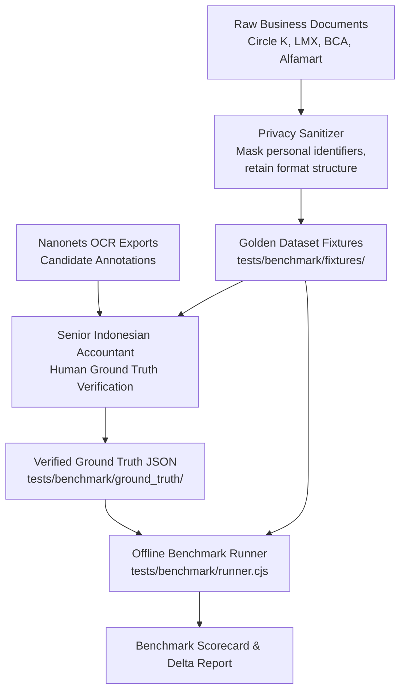

# CFO AI — Document Extraction Benchmark Plan & Golden Dataset Specification

**Date:** October 19, 2026  
**Component:** Document Extraction & OCR Pipeline  
**Target Invariant:** >= 99% Exact Match on Critical Monetary Fields and Statutory Tax Bases  
**Privacy Scope:** Strict Sanitization (No real bank passwords or private personal credentials in public code)  

---

## 1. Golden Dataset Architecture

To objectively evaluate and verify the document extraction pipeline, we establish an automated, offline **Golden Dataset** benchmark harness.

> [!IMPORTANT]
> **Candidate Annotations vs. Verified Ground Truth:**  
> Nanonets JSON exports are **candidate annotations**, not ground truth. Commercial OCR engines may misclassify multi-page bundles or confuse tax base DPP with commercial subtotal. Every case in the Golden Dataset must be verified against actual statutory accounting standards.

---

## 2. Core Benchmark Test Cases

### Case A — Circle K Indonesia (3-Page Commercial Package)
- **Document Type:** Multi-page Commercial Invoice Package (`invoice` with attached `faktur_pajak` and `contract`).
- **Jurisdiction:** Indonesia (IDR / DJP Coretax & UU HPP).
- **Physical Structure:**
  - Page 1: Commercial Supplier Invoice (`X2610001139`)
  - Page 2: Trade Activity Confirmation (TAC placement agreement)
  - Page 3: Electronic Tax Invoice (Faktur Pajak DJP `04002600313616020`)
- **Verified Ground Truth Values:**
  - **Issuer / Supplier:** `PT. Circleka Indonesia Utama` (NPWP: `00.207.974.4-507.000`)
  - **Buyer / Customer:** `PT. HELM CARE INDONESIA` (NPWP: `1000000002284592`)
  - **Invoice Date:** `2026-07-31`
  - **Estimated Payment Date:** `2026-08-14`
  - **Commercial Subtotal:** `IDR 129,600,000`
  - **Tax Base (DPP):** `IDR 118,800,000`
  - **PPN (12% of DPP):** `IDR 14,256,000`
  - **Total Payable Gross:** `IDR 143,856,000`
  - **Subtotal vs DPP Variance:** `IDR 10,800,000` (`129,600,000 - 118,800,000`)
- **Benchmark Invariants:**
  - Gross payable MUST equal `IDR 143,856,000` (must NOT be overwritten with `133,056,000`).
  - Variance of `IDR 10,800,000` must be recorded neutrally without being forced into an unapproved discount.
  - Zero-posting guard: status remains advisory.

---

### Case B1 — Location Media Xchange (LMX Singapore 1-Page SaaS Invoice)
- **Document Type:** International SaaS Invoice (`invoice`).
- **Jurisdiction:** Singapore (USD cross-border subscription).
- **Physical Structure:** 1-Page PDF Invoice (`IVLMXS-26-0215`).
- **Ground Truth Values:**
  - **Vendor:** `Location Media Xchange Pte Ltd`
  - **Invoice Number:** `IVLMXS-26-0215`
  - **Invoice Date:** `2026-10-05`
  - **Due Date:** `2026-10-19`
  - **Currency:** `USD`
  - **Total Amount Payable:** `USD 472.00`
  - **Line Items:** `Location Media Xchange Software Subscription`, Qty: `59`, Unit Price: `$8.00`, Line Total: `$472.00`.
- **Benchmark Invariants:**
  - Tabular extraction must capture Quantity (`59`), Unit Price (`8.00`), and Total (`472.00`).

---

### Case B2 — Bank Central Asia (BCA Outward Remittance Slip)
- **Document Type:** Bank Payment Proof (`payment_proof`).
- **Jurisdiction:** Indonesia / Cross-border remittance.
- **Physical Structure:** 1-Page BCA Remittance Confirmation (`BCA-REM-20260928-0914`).
- **Ground Truth Values:**
  - **Sender:** `PT HELM CARE INDONESIA`
  - **Beneficiary:** `LOCATION MEDIA XCHANGE PTE LTD`
  - **Settlement Date:** `2026-09-28`
  - **Settled Amount:** `USD 472.00`
  - **Bank Reference:** `BCA-REM-20260928-0914`
- **Benchmark Invariants:**
  - Date anomaly check: Payment date (`2026-09-28`) precedes invoice date (`2026-10-05`) by 7 days.
  - The reconciliation engine must flag advance prepayment for review rather than blindly closing payables.

---

### Case C — Alfamart Indonesia (3-Page Complex Retail Package)
- **Document Type:** Multi-Document Package (`receipt` + `faktur_pajak` + `contract/lease`).
- **Jurisdiction:** Indonesia (IDR / Retail Placement Lease).
- **Physical Structure:**
  - Page 1: Official Receipt (`Kwitansi` / Bukti Pembayaran `KW/ALFA/2026/08/0441`)
  - Page 2: Electronic Tax Invoice (`Faktur Pajak DJP 04002600492817201`)
  - Page 3: Store Space Lease Agreement (`Perjanjian Sewa AGR-ALFA-HLM-2026-03`)
- **Ground Truth Values:**
  - **Payee / Vendor:** `PT. Sumber Alfaria Trijaya Tbk`
  - **Kwitansi Total (Gross Paid):** `IDR 11,322,000` (Page 1)
  - **Lease Base (Harga Jual):** `IDR 10,200,000` (Page 2, 3)
  - **Tax Base (DPP):** `IDR 9,350,000` (Page 2)
  - **PPN (12% of DPP):** `IDR 1,122,000` (Page 1, 2)
  - **Lease Agreement Value:** `IDR 10,302,000` (Page 3, includes admin/stamp fees)
- **Benchmark Invariants:**
  - Direction: Kwitansi indicates an outflow voucher (`receipt`), NOT an open supplier payable.
  - Subtotal vs DPP: `IDR 10,200,000` (Lease base) must not be confused with `IDR 9,350,000` (DPP).
  - Status must be `needs_manual_review` due to multi-page lease complexity.

---

## 3. Missing Artifacts Inventory

The following original files are required from the user to complete the full empirical evaluation:

| Benchmark Case | Original Binary PDF | Nanonets JSON Export | Current State & Impact |
|---|---|---|---|
| **Case A (Circle K)** | **MISSING** | **MISSING** | Text and schema verified from production doc `cd850fe1-c214-43e3-8353-23c471dd8567`. Original PDF needed to evaluate rasterization and bounding boxes. |
| **Case B1 (LMX)** | **MISSING** | **MISSING** | Synthetic text fixture active. Original PDF and Nanonets JSON needed for table extraction baseline. |
| **Case B2 (BCA)** | **MISSING** | **MISSING** | Synthetic text fixture active. Original bank slip PDF needed for OCR font robustness. |
| **Case C (Alfamart)** | **MISSING** | **MISSING** | Synthetic text fixture active. Original 3-page scan needed for visual layout segmentation. |

---

## 4. Evaluation Metrics

1. **Exact Match (EM) Field Accuracy:** Strict binary string/number match on critical identifiers (NPWP, NSFP, Document Number).
2. **Monetary Precision:** Exact floating-point equality on subtotal, DPP, variance, PPN, and gross amounts.
3. **Line-Item F1 Score:** Precision and recall on table item descriptions, quantities, and unit prices.
4. **Zero-Posting Invariant:** 100% adherence to non-auto-committing extraction status.
