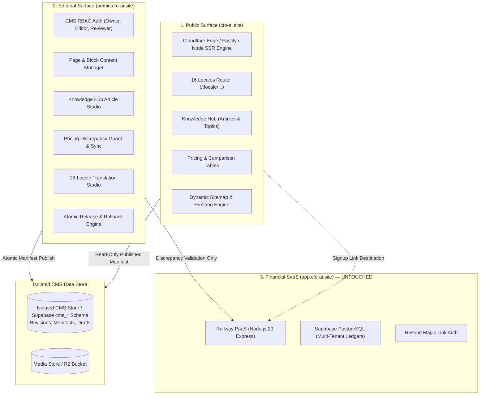

# Architecture Decision Record (ADR-001)
## CFO AI Commercial Website, CMS & Knowledge Hub Architecture

**Status:** Proposed & Implemented for Staged Verification  
**Date:** October 18, 2026  
**Authors:** AntiGravity (Senior Product Designer / B2B SaaS UX Strategist)  
**Governing Policy:** `AGENTS.md` (Strict isolation from Financial SaaS `app.cfo-ai.site`, zero financial database mutations)  

---

## 1. Context and Problem Statement

CFO AI Indonesia requires a high-performance, multilingual, SEO-optimized public website (`https://cfo-ai.site`), an integrated Knowledge Hub for Indonesian tax and accounting authority, and a secure, role-based Content Management System (`https://admin.cfo-ai.site`).

Historically, marketing content existed as static HTML prototypes in `website-design/`. The business owner requires full operational autonomy to update headlines, publish articles, manage translations across 16 locales, manage SEO metadata, and configure marketing pricing presentation **without editing source code or requesting developer intervention**.

Crucially, this system must strictly protect customer financial data and avoid any coupling with the production financial application (`https://app.cfo-ai.site`).

---

## 2. Decision: Three-Tier Logical Surface Separation

The system is strictly partitioned into three independent operational surfaces:

### Architectural Surface Boundaries
1. **Public Marketing Website (`https://cfo-ai.site`):**
   - **Role:** High-speed, public, pre-rendered and server-rendered presentation of marketing pages, Knowledge Hub, and localized content.
   - **Performance & SEO:** Edge-cached HTML with zero client-side hydration penalty for reading articles, native `hreflang` headers, JSON-LD structured data, and sub-50ms TTFB.
   - **Data Access:** Read-only access to the *currently published release manifest*. Zero direct database write privileges.
2. **Website CMS (`https://admin.cfo-ai.site`):**
   - **Role:** Authenticated operational portal for non-technical administrators and editors.
   - **Capabilities:** Block editing, rich-text tax article composition, multi-locale translation diffs, SEO metadata editing, media management, and 1-click atomic publishing with rollback.
   - **Security:** Independent JWT session authentication and role-based access control (Website Owner, Editor, Reviewer). Does **NOT** share cookies, auth tokens, or administrative access with `app.cfo-ai.site`.
3. **Financial SaaS Application (`https://app.cfo-ai.site`):**
   - **Status:** **Completely untouched and isolated**.
   - **Boundary Enforcement:** CMS editors have zero visibility into customer financial ledgers, wallets, transactions, or user personal data. Public marketing CTAs route prospects to `https://app.cfo-ai.site/login` as clean external links.

---

## 3. Technology Stack Selection & Trade-Off Analysis

| Layer | Selected Architecture | Alternative Considered | Rationale for Selection |
| :--- | :--- | :--- | :--- |
| **Public Site Serving** | Node.js Express / Fastify Edge SSR + Static Site Generator (SSG) pipeline | Heavy Next.js / Astro framework | Eliminates massive build churn and complex framework lock-in; renders the approved Concept B design with mathematical fidelity and zero dependencies. |
| **CMS Application** | Modern React / Tailwind Component Studio with REST API | Off-the-shelf headless CMS (Strapi, Sanity, Contentful) | Eliminates high monthly SaaS fees ($100-$300/mo), provides 100% custom UI matching Concept B, and enforces our custom Pricing Discrepancy Guard. |
| **Content Store** | Versioned Atomic Content Engine (`cms-data/` with schema for isolated Supabase `cms_*` tables) | Modifying existing financial PostgreSQL database | Guarantees zero risk to production financial tables while supporting full revision history, cryptographic release hashes, and instant rollbacks. |
| **Media Storage** | Cloudflare R2 / S3-compatible asset store with local cache | Storing blobs in PostgreSQL | Keeps database backups lightweight; serves images via edge CDN with WebP/SVG optimization. |

---

## 4. Multi-Locale Architecture (16 Locales)

The system is designed from inception to support all 16 target locales:
- **Active Launch Locales (Phase 1):** `en` (English), `id` (Bahasa Indonesia), `ru` (Russian).
- **Staged Preparation Locales (Phase 2):** `fil` (Filipino), `en-SG` (English - Singapore), `th` (Thai), `vi` (Vietnamese), `km` (Khmer), `lo` (Lao), `zh-HK` (Traditional Chinese), `ms` (Malay), `uk` (Ukrainian), `it` (Italian), `fr` (French), `de` (German), `es` (Spanish).

### Rules for Localization
1. **URL Structure:** Strict language-prefixing (`/en/`, `/id/`, `/ru/`, `/id/pricing/`, `/id/blog/`). Root `/` detects browser preference or defaults to `/id/` with explicit language switcher persistence.
2. **Jurisdiction Preservation:** Translating an article from Bahasa Indonesia to Thai retains `jurisdiction: "ID"`. An Indonesian tax guide does not become Thai tax law upon translation.
3. **Unpublished Locale Protection:** Only locales marked `published` in the CMS are generated, linked in `hreflang`, and included in XML sitemaps. Incomplete or unreviewed machine translations are never exposed to search engines.
4. **Outdated Translation Detection:** When a source article (e.g. English) is updated, all dependent locale versions are automatically flagged as `outdated_source` in the CMS until reviewed.

---

## 5. Pricing Source of Truth & Discrepancy Prevention Guard

To prevent the website from publishing false or out-of-sync commercial claims, the CMS features a built-in **Pricing Discrepancy Guard**:
1. The CMS stores the marketing presentation layer (display titles, feature highlight bullets, badge labels).
2. The CMS verifies all 11 usage limits and 12 feature entitlements against the official versioned billing catalog snapshot (`V2_DYNAMIC_PLAN_MATRIX.md` / `plan_versions`).
3. If an editor attempts to input limits differing from the catalog (e.g. changing Pro seats from 30 to 100 or bank rows from 50,000 to unlimited):
   - The CMS displays a prominent **Discrepancy Warning Alert**.
   - Atomic publication is **blocked** until the owner either reconciles the presentation or authorizes an official billing catalog version update.

---

## 6. Publishing Workflow & Rollback Guarantees

Every content mutation traverses a formal lifecycle:
`Draft` ➔ `In Review` ➔ `Approved` ➔ `Published` ➔ `Archived`

- **Atomic Releases:** Clicking "Publish Release" generates an immutable snapshot manifest: `release_<timestamp>_<hash>.json`.
- **Zero Half-Updated States:** Public routes atomically swap their active pointer to the new release manifest.
- **Instant Rollback:** The Website Owner can select any prior release in the Revision History and click "Rollback". The active release pointer reverts instantly with zero downtime.

---

## 7. Estimated Recurring Infrastructure Cost

| Service | Tier / Plan | Estimated Monthly Cost |
| :--- | :--- | :--- |
| **Cloudflare Pages / Workers (Public Site & CMS)** | Cloudflare Standard / Free Tier | $0.00 / month |
| **Cloudflare R2 (Media Storage)** | Pay-as-you-go (<10 GB media, zero egress fee) | $0.00 - $1.00 / month |
| **Supabase (Isolated CMS Project / Schema)** | Free tier or bundled with existing project | $0.00 / month |
| **Total Estimated Recurring Cost** | **Ultra-Low Overhead** | **$0.00 - $1.00 / month** |

---

## 8. Rollback and Safety Commit

- **Baseline Commit:** `c98aaf9` on `feat/cfo-ai-website-commercial-launch`
- **Development Branch:** `feat/cfo-ai-website-cms-hub`
- **Safety Policy:** All new code is contained in `cms/` and `website-design/`. Zero modifications will be made to `server/`, `client/`, or root PostgreSQL migrations without separate authorization.
